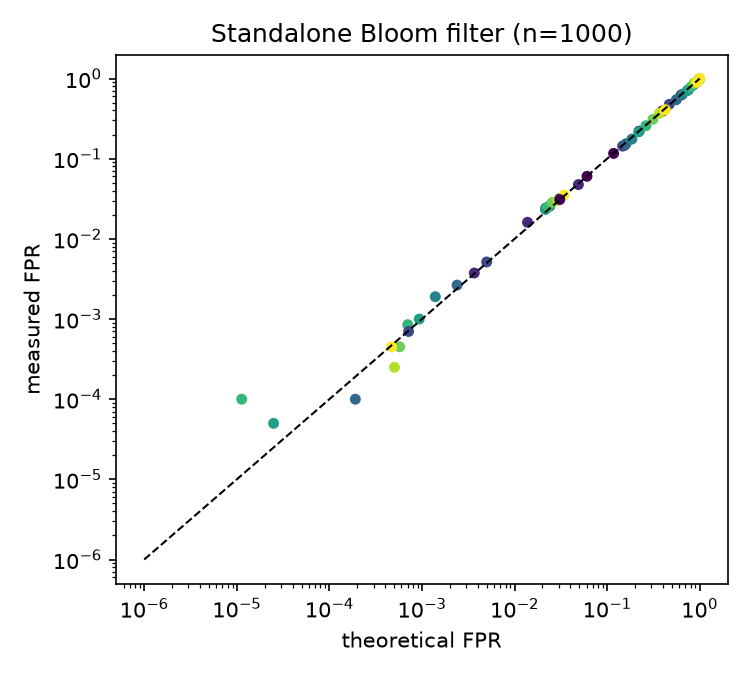
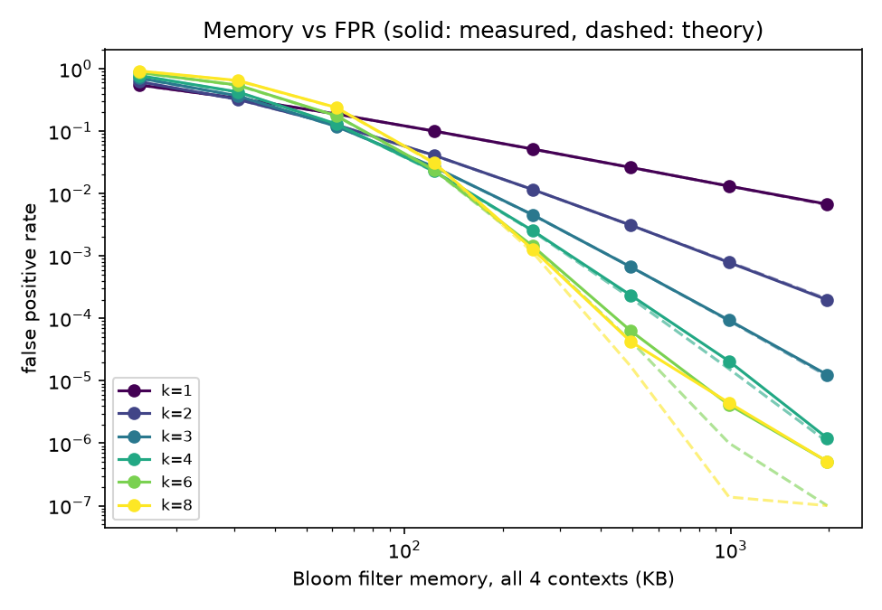
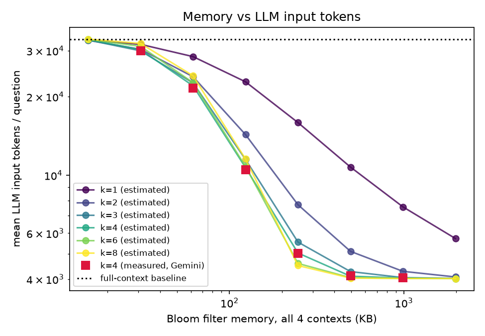
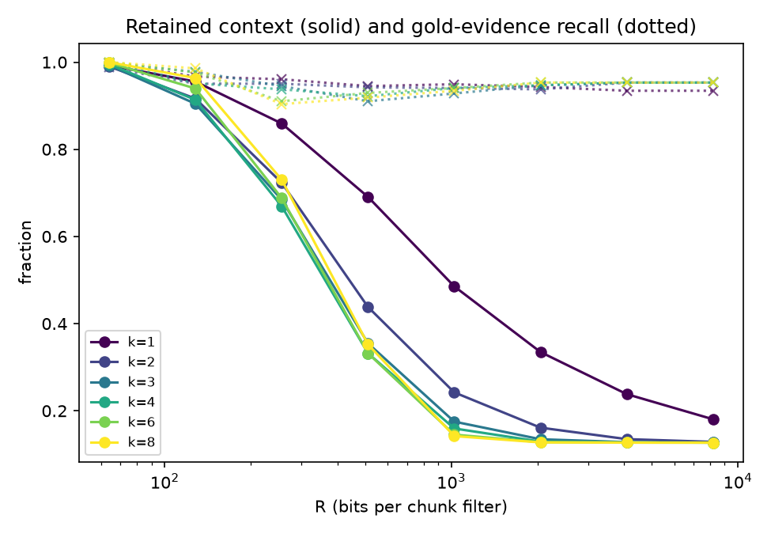
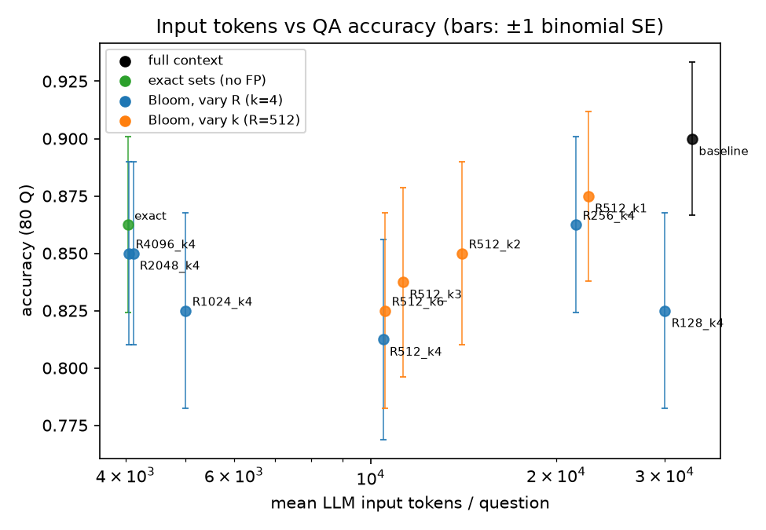

# HW1 Report — Bloom Filters for LLM Context Compression

COMP 480/580, Fall 2026 · Fanjiang Ye (fy27), Kaijian Wang (kw118)

## 1. Method

**Bloom filter.** `BloomFilter` stores R bits in a packed `uint8` array. The k positions of an item come from one keyed 128-bit BLAKE2b digest split into (h1, h2), combined with enhanced double hashing `h1 + i·h2 + (i³−i)/6 mod R`. That way k hash functions cost one hash computation. There are no false negatives (the experiment script asserts this).

**Bit-sliced per-chunk Bloom index.**
- The context is split into chunks: paragraphs and list items, cut at sentence boundaries to at most 80 words, with headings shorter than 15 words glued to the following chunk. This gives 245–671 chunks per context, with 40–68 terms per chunk.
- Each chunk gets its own Bloom filter holding its terms: lower-cased, lightly stemmed unigrams plus adjacent content-word bigrams, with stopwords removed.
- All C filters share R and k, so they are stored transposed as an R × C bit matrix (`BitSlicedBloomIndex`). Row p is the set of chunks whose filter has bit p set.
- Testing one term against every chunk is the AND of its k rows, which touches k·C/8 bytes. The C separate probes it replaces would have been far slower. The index costs exactly R·C bits.

**Compression (per question).**
1. Extract the question's terms with the same function used for the chunks.
2. Query each term against the index. The popcount of each answer gives a Bloom-estimated document frequency df (false positives inflate it). Turn df into a BM25-style IDF weight.
3. Score each chunk as the IDF-weighted count of question terms its filter reports.
4. Keep every chunk with `score ≥ 0.15 · max score`, the ±1 neighbours of the 3 best chunks, and the document's first chunk (preamble or conventions). Emit them in original order, with `[...]` marking gaps.

This rule needs no per-dataset tuning and adapts to the question:
- Aggregate questions ("how many entries name X") keep every chunk that mentions X.
- Lookups keep a handful of chunks.
- If nothing matches, the full context is returned.

**False positives enter twice.** A false positive adds a spurious hit to some chunk, and it also inflates df, which lowers that term's IDF. When R is small relative to the number of items per chunk, filters saturate: every chunk matches everything and the method degrades gracefully to the full context.

**Prompt.** The baseline and every Bloom configuration use the identical prompt (`PROMPT` in `run_experiments.py`): instructions, then the document, then the question. Model settings are `gemini-3.5-flash-lite`, temperature 0, seed 0.

**Metrics.**
- *Accuracy*: graded against `expected` + `aliases`. Numeric answers use the first number in the reply, with ±0.5 % relative tolerance and "million/billion" scaling. Text answers use a case-insensitive, normalised match.
- *Tokens*: Gemini's `usage_metadata.prompt_token_count`.
- *Latency*: index build (once per context, amortised over its 20 questions) + retrieval + LLM call.
- *Memory*: Bloom index bytes, plus peak Python heap measured by `tracemalloc` while building the index and compressing.
- *Gold-evidence recall* (offline proxy, evaluation only): the fraction of the answer file's `gold_spans` quotes that survive compression verbatim.

## 2. Results

### 2.1 Single Bloom filter: measured vs. theoretical FPR (n = 1000, 20 000 non-member probes)

| R (bits/item) | k=1 meas / theory | k=4 meas / theory | k=7 meas / theory |
|---|---|---|---|
| 2 000 (2) | 0.391 / 0.394 | 0.545 / 0.559 | 0.790 / 0.807 |
| 4 000 (4) | 0.221 / 0.221 | 0.154 / 0.160 | 0.258 / 0.263 |
| 8 000 (8) | 0.116 / 0.118 | 0.0255 / 0.0240 | 0.0251 / 0.0229 |
| 16 000 (16) | 0.0604 / 0.0606 | 0.0027 / 0.0024 | 0.0008 / 0.0007 |

### 2.2 Chunk index over the 4 v1 contexts (offline sweep, 80 questions)

Memory is the sum over the 4 contexts (C = 1966 chunks). FPR is measured with 2000 random non-member probes per filter. "Tokens" is the estimated mean prompt size per question: characters ÷ 4.25, calibrated on the full-context prompts, where Gemini reported 33 248 tokens per question. The estimate matches the Gemini-reported counts in §2.3 to within about 2 %; for example, R=2048 gives 4 105 estimated vs 4 118 measured.

| R | k | memory | measured FPR | theory FPR | retained context | est. tokens/question | gold recall |
|---|---|---|---|---|---|---|---|
| 64 | 4 | 15 KB | 0.776 | 0.769 | 99.5 % | 33 086 | 1.00 |
| 128 | 4 | 31 KB | 0.425 | 0.421 | 91.3 % | 30 289 | 0.95 |
| 256 | 4 | 62 KB | 0.131 | 0.130 | 66.9 % | 22 021 | 0.94 |
| 512 | 4 | 124 KB | 0.023 | 0.022 | 33.2 % | 10 706 | 0.92 |
| 1024 | 4 | 247 KB | 2.6e-3 | 2.5e-3 | 15.9 % | 5 036 | 0.94 |
| 2048 | 4 | 494 KB | 2.3e-4 | 2.1e-4 | 12.9 % | 4 105 | 0.95 |
| 4096 | 4 | 988 KB | 2.1e-5 | 1.6e-5 | 12.8 % | 4 039 | 0.95 |
| 8192 | 4 | 1.92 MB | 1.2e-6 | 1.1e-6 | 12.7 % | 4 021 | 0.95 |
| 1024 | 1 | 247 KB | 0.052 | 0.052 | 48.6 % | 15 917 | 0.95 |
| 1024 | 2 | 247 KB | 0.012 | 0.012 | 24.2 % | 7 711 | 0.94 |
| 1024 | 8 | 247 KB | 1.3e-3 | 1.1e-3 | 14.2 % | 4 510 | 0.93 |
| exact sets (no FP) | – | 10.3 MB | 0 | 0 | 12.7 % | 4 021 | 0.95 |

The full grid is in `results/sweep_offline.csv`. Retrieval takes about 0.12–0.2 ms per question; building the index takes 10–60 ms per context.

### 2.3 LLM results (gemini-3.5-flash-lite, 80 questions, identical prompt)

| config | accuracy | T1 / T2 / T3 | total input tokens | tokens/question | context kept | gold recall | Bloom index | median latency/question |
|---|---|---|---|---|---|---|---|---|
| **full context (baseline)** | **0.900** | 1.00 / 0.88 / 0.58 | 2 659 864 | 33 248 | 100 % | 1.000 | – | 0.62 s |
| exact sets (no FP) | 0.863 | 0.95 / 0.83 / 0.58 | 323 011 | 4 037 | 12.7 % | 0.953 | 10.3 MB | 0.43 s |
| Bloom R=128, k=4 | 0.825 | 0.95 / 0.79 / 0.42 | 2 402 540 | 30 031 | 91.3 % | 0.951 | 30.9 KB | 0.85 s |
| Bloom R=256, k=4 | 0.863 | 0.95 / 0.88 / 0.50 | 1 723 683 | 21 546 | 66.9 % | 0.938 | 61.8 KB | 0.71 s |
| Bloom R=512, k=4 | 0.812 | 0.95 / 0.79 / 0.33 | 838 172 | 10 477 | 33.2 % | 0.922 | 123.5 KB | 0.56 s |
| Bloom R=1024, k=4 | 0.825 | 0.91 / 0.79 / 0.58 | 400 896 | 5 011 | 15.9 % | 0.941 | 247 KB | 0.47 s |
| **Bloom R=2048, k=4** | **0.850** | 0.95 / 0.79 / 0.58 | **329 447** | **4 118** | 12.9 % | 0.947 | **494 KB** | **0.48 s** |
| Bloom R=4096, k=4 | 0.850 | 0.95 / 0.79 / 0.58 | 324 359 | 4 054 | 12.8 % | 0.953 | 988 KB | 0.44 s |
| Bloom R=512, k=1 | 0.875 | 0.95 / 0.92 / 0.50 | 1 804 209 | 22 552 | 69.1 % | 0.945 | 123.5 KB | 0.77 s |
| Bloom R=512, k=2 | 0.850 | 0.95 / 0.83 / 0.50 | 1 126 022 | 14 075 | 43.8 % | 0.942 | 123.5 KB | 0.97 s* |
| Bloom R=512, k=3 | 0.838 | 0.93 / 0.88 / 0.42 | 902 762 | 11 284 | 35.5 % | 0.910 | 123.5 KB | 0.67 s |
| Bloom R=512, k=6 | 0.825 | 0.93 / 0.79 / 0.50 | 844 725 | 10 559 | 33.2 % | 0.929 | 123.5 KB | 0.72 s |
| Bloom R=512, k=8 | pending (quota) | | | | | | | |

Tier sizes are T1 lookup (44), T2 multi-hop (24) and T3 aggregate (12).

- **Latency.** Median latency per question is the robust number to read; the full mean and total are in `llm_summary.csv`. Bloom retrieval, including the index build amortised over the 20 questions of a context, costs about 1.9 ms per question. Everything else is the Gemini call.
- **\*k=2 outlier.** The k=2 run happened near the rate limit, and a few Gemini calls took 50–190 s on the server side. Its total latency (1198 s) is therefore an outlier, while its median is normal.
- **Memory.** The Bloom index is R·C bits, shown in the table. Peak Python heap for the whole pipeline is about 8–9 MB in every configuration. That figure is dominated by the context text, the chunk strings and the per-chunk term sets that the experiment code keeps for exact FPR measurement, not by the filters.
- **Noise.** With 80 questions, one binomial standard error is about ±4 percentage points, so most differences among the Bloom configurations, roughly 81–88 %, are within noise. The error bars in `tokens_vs_accuracy.png` show this.

- **Answers do not depend on the context alone.** Several questions flip between configurations that have identical gold-evidence recall, for example `harbour-T2-001` and `dwh-T2-005`. In those cases the LLM's answer changes because of what else is in the context, not because evidence was lost.

## 3. Answers to the questions

1. **Measured vs. theoretical FPR.** The measured FPR matches (1−e^{−kN/R})^k closely everywhere, usually within a few percent relative (tables 2.1 and 2.2), both for random probes and for the real question terms (`query_term_fpr`). The approximation slightly over-estimates in the saturated regime, where it ignores the exact (1−1/R)^{kN} form. At FPR below about 1e-5 the measurement is noise-limited: 2000 probes × ~2000 chunks ≈ 4·10⁶ trials, so a handful of events decide the value. In that range the measured FPR stays a little above theory, which is consistent with the known double-hashing floor.
2. **Effect of R and k.** Memory is exactly R·C bits, linear in R and independent of k. FPR falls roughly exponentially in R/N, bits per item (N ≈ 50 items per chunk here). For a fixed R, FPR is U-shaped in k with its minimum near k = (R/N) ln 2. The measured best is k=3 at R=256, k≈4–6 at R=512 and k≥6 at R≥1024; N varies across chunks, so the optimum sits a little below the formula's value for the mean N. A too-small k (k=1) wastes memory. A too-large k at small R saturates the filter (k=8 at R=128 gives FPR 0.65 vs 0.32 for k=2).
3. **Effect of false positives on context, tokens and accuracy.** Each false positive gives some irrelevant chunk a spurious term hit. Because the keep rule is relative (`0.15·max`), a few spurious hits on rare terms are enough to pull a chunk in. Retained context therefore grows quickly with FPR: 12.7 % at FPR ≈ 0, 16 % at 2.5e-3, 33 % at 2.3e-2, 67 % at 0.13, and nearly 100 % at 0.4 or more. Input tokens grow in proportion: 4.1 k per question at R=2048, 10.5 k at R=512 and 30 k at R=128.

   False positives do **not** only add tokens. A Bloom filter never misses a term, but the selection rule is relative, and false positives distort the ranking in two ways:
   - They inflate the estimated df, which flattens the IDF weights.
   - They hit long chunks more often, because long chunks have fuller filters.

   As a result, a short evidence chunk can fall below `0.15·max`. Gold-evidence recall shows this: 0.953 with exact sets, 0.922 at R=512, 0.938 at R=256. For example, at R=128 the answer passage for `dwh-T1-006` is dropped even though 91 % of the document is kept.

   Accuracy reflects both effects. Mid-size filters (R=512, k≥3) are the worst point, at 0.81–0.84: they keep 3× the tokens of exact sets yet lose some evidence. Very small filters (R≤256, or k=1) push accuracy back toward the baseline, to 0.86–0.88, only because they keep most of the document.
4. **Achievable reduction.**
   - **Tokens.** With R=2048, k=4 (494 KB for all four contexts), input tokens fall from 2.66 M to 0.33 M. That is **−87.6 %**, or 33.2 k → 4.1 k per question.
   - **Accuracy.** Accuracy drops from 0.900 to 0.850, a loss of 4 of 80 questions. That is about one standard error, and within one question of the exact-set oracle (0.863).
   - **Latency.** Median latency per question falls from 0.62 s to 0.48 s.
   - **Where the losses are.** All of the loss is on T1 lookups (1.00 → 0.95) and T2 multi-hop questions (0.88 → 0.79). T3 aggregates stay at 0.58, the same as the full context.
   - **Middle ground.** If accuracy matters more than tokens, R=512, k=1 reaches 0.875 at 32 % fewer tokens.
5. **Is a larger filter always better?** No. Tokens drop steeply up to about 20 bits per item (R ≈ 1024 here). Beyond that, the FPR is already far below 1/C, so almost no false-positive chunks remain. Doubling memory again (2048 → 8192) saves under 2 % more tokens and leaves recall and accuracy unchanged: retrieval quality is then limited by the lexical scoring, not by the filter. Measured with Gemini, R=4096 gives the same accuracy as R=2048 (0.850) and saves only 1.5 % of tokens, for twice the memory. Going the other way, a smaller filter is not always worse for accuracy either: the saturated R=256 filter scores 0.863 because it simply sends 5× more tokens. The exact-set oracle uses about 20× the memory of R=2048 for the same retained context. The useful operating point is the knee near FPR ≈ 1/C.
6. **Limitations.**
   - A Bloom filter only answers exact-term membership. It has no notion of synonyms or paraphrase ("slip" vs "berth", "custodian" vs "keeper"; `harbour-T1-008` asks for "the first slip, the most westerly", while the text says "berth 1", so even exact sets miss it), semantics, numbers written differently, or term frequency and positions.
   - Chunks cannot be enumerated from a filter, so multi-hop expansion has to re-read chunk text.
   - Questions whose answer depends on structure rather than words lose context. Examples: counting all entries in a section, or a table header far from its row.
   - The FPR depends on the number of items per chunk, so a single global R over-provisions short chunks and under-provisions long ones.
   - Filters cannot delete or update items.
   - The retained context still has to be re-tokenised by the LLM, and latency is dominated by the LLM call, not by Bloom retrieval (well under 1 ms).
